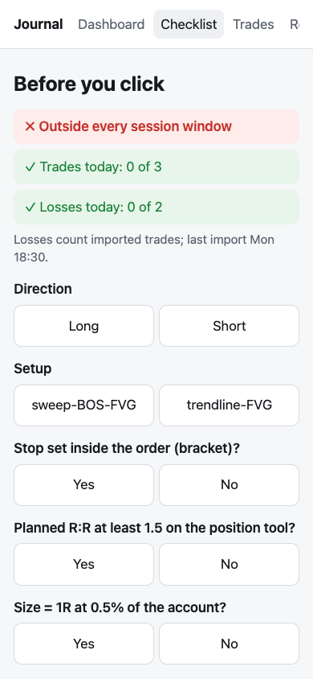
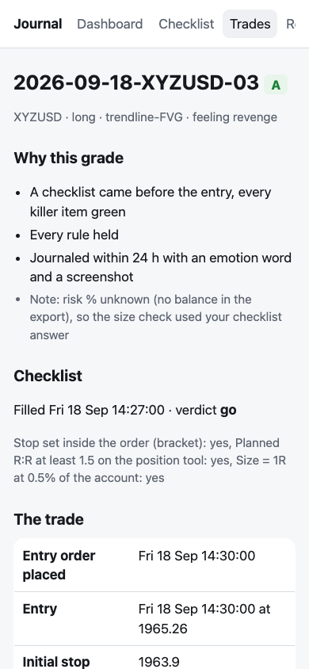
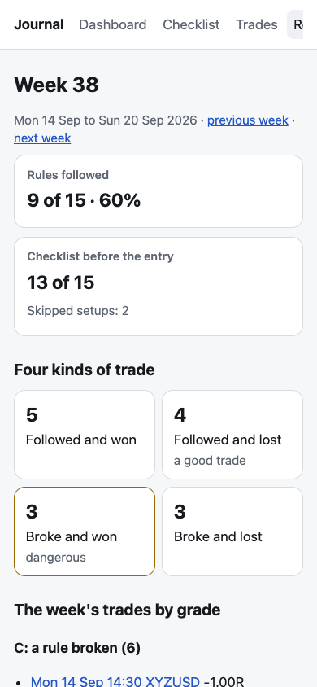

# trade-journal

A private trade journal that grades how you traded, not what you made.

A 30-second checklist before each entry, a TradingView paper-trading export
that fills in every number, and one page that opens on how often the rules
were followed, then shows the R curve and where you stand against an honest
50-trade checkpoint. It runs on one Mac, with the standard library only.

| Checklist | A trade | Weekly review |
|---|---|---|
|  |  |  |

*Every screenshot is the made-up demo (`bin/journal demo`). No real trade is in this repo.*

## Why it grades the process

- Fewer than 1% of day traders reliably beat the market after fees (Barber, Lee, Liu & Odean 2014).
- Monitoring behaviour improved behaviour (d = 0.79) but not outcomes (d = 0.14, not significant); monitoring outcomes improved outcomes (d = 0.62) (Harkin et al. 2016).
- People rate the same decision better when it turned out well (Baron & Hershey 1988).
- At 50 trades, 25 wins means a true win rate anywhere from 37% to 63%. A system making +0.2R per trade can't be told from a losing one.

So the journal scores the process, which 50 trades *can* judge, shows every rate with its range, and says "too few to tell" under ten trades. No study shows journaling itself improves P&L; this one doesn't claim to.

## How a trade gets in (under a minute, no prices typed)

1. **Before the entry, about 30 s (phone or Mac).** The checklist page shows the journal's own checks (trades today against the max, losses today against the stop-after count, inside a session window) and asks three questions: stop set in the order, planned R:R at the minimum, size = 1R. Every killer item green says **Go**; any red says **Rulebook says no trade**. Its timestamp proves it came first.
2. **The trade happens in TradingView** paper trading.
3. **After the exit, about 20 s.** Export *History* from the Paper Trading panel and drop it on the import page. The importer rebuilds each round trip from the orders (entry, bracket stop and target, exit, fees), works out 1R, R and the planned R:R, and links the checklist filled just before. The same file twice changes nothing.
4. **Optional, about 10 s.** Drop a screenshot on the trade, or attach one from `~/Downloads` saved near the trade's time.

## The grade

| Grade | Means |
|---|---|
| **A** | A checklist came before the entry with every killer item green; every rule held; journaled within 24 h with an emotion word and a screenshot. |
| **B** | Every rule held, with a housekeeping slip: no screenshot, no emotion word, or journaled late. |
| **C** | A rule broken, taken anyway after a red checklist, or no checklist. |

The rules: max trades a day; stop after N losses (only losses closed before the entry count); risk within tolerance of the set %; the stop in the order (not added after the entry) and never moved further away; planned R:R at least the minimum; inside a session window. Each trade says, in words, what decided its grade. The grade can't be edited; if the data is wrong, fix the data and the grade follows (every fix is logged).

## The numbers

Rule adherence and checklist use first. Then the equity curve in R with drawdowns shaded, a half-R histogram, and: win rate with a 95% Wilson interval; expectancy with a studentised bootstrap range, labelled rough and never used as a gate; profit factor; average win and loss; deepest drawdown in R; the four kinds of trade (followed and won, followed and lost, broke and won, broke and lost); results by setup, session window, weekday and emotion word. Money appears only on a trade's own page. There are no streaks.

The weekly review lists the week's trades by grade with their reasons and keeps three answers: what led to each C, one rule to keep, and one change written as an if-then with a time and a place.

## Privacy

- Everything lives in `~/Library/Application Support/trade-journal/` (owner-only): the journal (SQLite), screenshots, the rulebook and settings. Backups go to `~/Backups/trade-journal/`. The code refuses any data folder under `~/Documents`, `~/Desktop`, iCloud Drive or a git repo.
- Nothing leaves the Mac. There are no accounts, no API keys, no exchange connections and no third-party packages. The charts are SVG drawn by the journal; no page loads anything from the internet.
- The command line prints counts, never prices, symbols or notes, so an AI helper running it sees no trades.

## Quick start

```sh
bin/journal init                 # private folder, journal, rulebook (placeholders), settings
bin/journal migrate old.csv      # optional: an older 27-column tracker, once
bin/journal start                # serve it in the tmux session "journal"
open http://127.0.0.1:8765/
bin/journal status               # counts, service, last import, backups
```

`bin/journal demo` builds a made-up journal in a temp folder and serves it on port 8799.

After a reboot, run `bin/journal start` again.

## The rulebook

`rulebook.toml` holds the trading rules (examples/rulebook.toml shows every key). Each trade is graded under the version in force on its entry day. A version marked `placeholder = true` may change and re-grades its trades; once its numbers are real and a trade is graded under them, they lock, and new numbers need a new version with its own `effective_from`. `checkpoint_reading` decides how the 50-trade checkpoint reads expectancy: `point` (below 0 means change the setup) or `interval` (only a range wholly below 0 does). `grading_starts` sets when grading begins: `"first-checklist"` (the first trade that came with a checklist) or a time like `"2026-10-05T14:00"`; trades before it are shown but never graded or counted.

## Settings

The journal keeps its days in South African time (SAST, UTC+2): day boundaries, the session windows (`session_windows_sast`), rulebook dates and the grading start. TradingView's export timezone is a separate setting.

`settings.toml` (examples/settings.toml): TradingView's timezone, the checklist window, the port, futures point values, and how a phone reaches the journal:

- `tailnet = "off"`: this Mac only (the default).
- `tailnet = "serve"`: the journal stays on localhost and a Tailscale Serve rule forwards the tailnet port to it.
- `tailnet = "bind"`: the journal listens on the Mac's Tailscale address too (the macOS firewall must allow Python).

Never on every address, never on the home network, never on the internet.

## Security

The server binds only to localhost or a Tailscale address (anything else is refused before binding), answers only its own host names (no DNS rebinding), and accepts only posts that carry the page's token from a same-origin page. Pages are never cached and run under a strict content-security policy; uploads are size-limited and only PNG or JPEG screenshots are kept.

## The TradingView format

TradingView documents its export tabs but not their column headers or timezone. The importer follows other journals' documentation of the History columns (Symbol, Side, Type, Qty, Limit Price, Stop Price, Fill Price, Status, Commission, Placing Time, Closing Time, Order ID…) and refuses any other layout with the list of columns to switch on. `bin/journal inspect FILE` reports a real export's layout in names and counts only, to confirm it.

Known limits:

- If TradingView modifies a stop in place, History shows only the final stop. A stop moved to break-even then hides the original 1R; the journal flags the trade and asks for the initial stop rather than guessing, and "never moved further away" is checked only when the export shows a second stop order.
- TradingView nets each symbol into one position, so a second entry while one is open is scaling in.
- History keeps the last 100 orders: export after each session.
- Fees are in the account currency; for instruments quoted in another currency, R ignores the conversion and a realised-P&L cross-check (from Account history) flags large differences.

## Development

```sh
bin/test                         # the suite: made-up data in temp folders only
TJ_TMUX_TEST=1 bin/test -k real  # also start and stop a real tmux session
```

Python 3.11 or later, standard library only; tests use pytest (run on 3.11 to 3.14). A synthetic generator (`tradejournal/synth.py`) makes bracket orders with wins, losses, manual exits and deliberate rule breaks, and the grader must reach the grade the generator expects for every trade.

## Licence

MIT; see [LICENSE](LICENSE).
